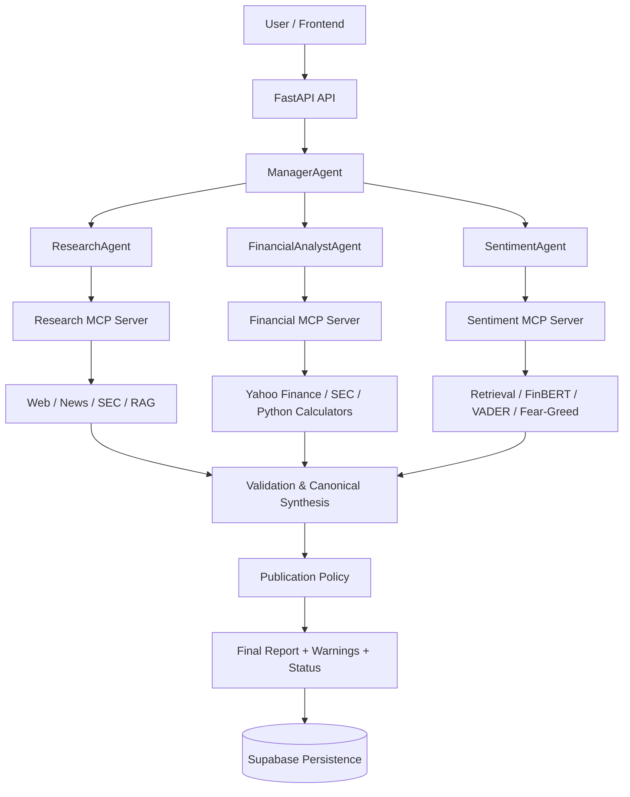

<div align="center">

# AgenticAlpha

### پلتفرم چندعاملی تحلیل مالی، پژوهش بازار و سنجش احساسات

[](https://www.python.org/)
[](https://fastapi.tiangolo.com/)
[](https://langchain-ai.github.io/langgraph/)
[](https://modelcontextprotocol.io/)
[](https://www.anthropic.com/)

**از پرسش طبیعی کاربر تا گزارش مالی ساخت‌یافته، همراه با شواهد، محاسبات قطعی و کنترل کیفیت چندلایه**

</div>

---

## معرفی

AgenticAlpha یک سیستم هوش مالی چندعاملی است که تحلیل یک شرکت بورسی را میان چند Agent تخصصی تقسیم می‌کند. سیستم می‌تواند داده‌های مالی، اخبار، اسناد SEC و شواهد sentiment را جمع‌آوری کند، محاسبات مالی را انجام دهد و در پایان گزارشی با وضعیت کیفیت و انتشار مشخص تولید کند.

نمونه‌ی درخواست:

> چشم‌انداز سرمایه‌گذاری ۳ تا ۱۲ ماهه‌ی Apple را با تمرکز بر رشد، valuation، ریسک‌ها، گزارش‌های SEC و اخبار اخیر تحلیل کن.

پروژه فقط یک prompt بزرگ نیست. تصمیم‌های زبانی، اجرای ابزارها، محاسبات عددی و validation در لایه‌های جدا انجام می‌شوند تا احتمال تولید عدد یا ادعای بدون پشتوانه کاهش یابد.

> [!IMPORTANT]
> خروجی این پروژه ابزار پشتیبان تحلیل است و نباید به‌عنوان توصیه‌ی قطعی سرمایه‌گذاری استفاده شود.

## قابلیت‌های اصلی

- orchestration سه Agent تخصصی با `LangGraph`؛
- جست‌وجوی وب، خبر و اسناد `SEC EDGAR`؛
- استخراج داده از `Yahoo Finance` و `XBRL`؛
- محاسبه‌ی نسبت‌های مالی، DCF، Reverse DCF و Monte Carlo؛
- Hybrid RAG با `Supabase pgvector` و `Neo4j`؛
- تحلیل sentiment با `FinBERT` و `VADER`؛
- ارتباط Agentها با ابزارها از طریق `MCP`؛
- validation مالی، دوره‌ای، ادعا و publication؛
- گزارش پیشرفت زنده با `Server-Sent Events`؛
- حافظه‌ی کوتاه‌مدت و بلندمدت؛
- logging و پشتیبانی از `Sentry` و `LangSmith`.

---

## معماری سیستم



### جریان ManagerAgent

```text
hydrate
   ↓
brain_route
   ├── run_research  ─┐
   ├── run_financial ─┼─→ evaluate → persist → brain_route
   └── run_sentiment ─┘
   ↓
finalise → validate → publication policy → END
```

ManagerAgent تصمیم LLM را مستقیماً اجرا نمی‌کند. actionها محدود و normalize می‌شوند، نتیجه‌ی هر Agent بررسی می‌شود و retry فقط در محدوده‌ی loop و شرایط تعریف‌شده انجام می‌گیرد.

---

## Agentها

| Agent | مسئولیت | ابزار و داده | خروجی اصلی |
|---|---|---|---|
| `ManagerAgent` | routing، ارزیابی، synthesis و انتشار | LangGraph، memory و validatorها | گزارش نهایی و publication metadata |
| `ResearchAgent` | گردآوری شواهد پژوهشی | Tavily، NewsAPI، SEC و RAG | research context همراه metadata |
| `FinancialAnalystAgent` | extraction و محاسبات مالی | Yahoo Finance، SEC/XBRL و calculatorهای Python | metricها، valuation و financial sanity |
| `SentimentAgent` | سنجش احساسات متن‌های مرتبط | Retrieval، FinBERT، VADER و Fear/Greed | polarity، confidence، coverage و audit |

### Research pipeline

```text
Brain Plan → MCP Tool Execution → Context Collection → Completeness Checker
      ↑                                                    │
      └──────────────────── retry with feedback ───────────┘
```

### Financial pipeline

```text
Intent Planning
      ↓
Deterministic Tool Resolution
      ↓
Financial Extraction → Derived Facts → Python Calculations
      ↓
Completeness + Financial Sanity Checker
```

در این مسیر، LLM نوع تحلیل را انتخاب می‌کند؛ اما آرگومان‌های عددی calculatorها از داده‌های استخراج‌شده توسط Python ساخته می‌شوند.

### Sentiment pipeline

```text
Retrieval
   ↓
FinBERT + VADER
   ↓
Fear/Greed Composition
   ↓
Coverage & Quality Validation
   ↓
Aspect/Causal Audit
   ↓
Final Sentiment Summary
```

---

## Technology Stack

| لایه | فناوری |
|---|---|
| Language | Python 3.12+ |
| API | FastAPI، Uvicorn و Pydantic |
| Agent orchestration | LangGraph `StateGraph` |
| LLM | Anthropic Claude |
| Tool protocol | Model Context Protocol — MCP |
| Financial data | Yahoo Finance و SEC EDGAR/XBRL |
| Research | Tavily، NewsAPI و SEC |
| Sentiment | ProsusAI/FinBERT و NLTK VADER |
| Embeddings | `BAAI/bge-small-en-v1.5` |
| Vector store | Supabase pgvector و FTS |
| Knowledge graph | Neo4j |
| Persistence | Supabase PostgreSQL |
| Evaluation | pytest، validatorهای داخلی و RAGAS scripts |
| Observability | Logging، Sentry و LangSmith |

---

## ساختار پروژه

```text
AgenticAlpha/
├── main.py                         # اجرای کامل: RAG seed سپس API
├── agents/
│   ├── manager_agent.py            # Orchestrator اصلی
│   ├── research_agent.py           # پژوهش و گردآوری context
│   ├── financial_agent.py          # تحلیل و محاسبات مالی
│   ├── sentiment_agent.py          # pipeline تحلیل احساسات
│   ├── state.py                    # قرارداد stateهای LangGraph
│   ├── prompts/                    # promptهای Agentها
│   └── executor_helpers/           # منطق کمکی و deterministic
├── api/
│   ├── main.py                     # FastAPI application
│   ├── config.py                   # تنظیمات محیطی
│   ├── dependencies.py             # dependency injection
│   └── routes/
│       ├── analyze.py              # تحلیل و پاسخ نهایی
│       └── progress.py             # SSE progress stream
├── tools/
│   ├── research_tools/             # ابزارهای جست‌وجو و SEC
│   ├── financial_tools/            # extraction و calculatorهای مالی
│   └── sentiment_tools/            # FinBERT، VADER و Fear/Greed
├── rag/
│   ├── seed.py                     # seed اولیه‌ی RAG
│   ├── ingestion.py                # ETL اسناد
│   ├── loader.py                   # خبر و RSS/Reddit
│   ├── processor.py                # chunking و deduplication
│   ├── embedding_manager.py        # ساخت embedding
│   ├── vector_store.py             # Supabase hybrid search
│   ├── graph_store.py              # Neo4j graph store
│   └── retriever.py                # retrieval و رتبه‌بندی
├── evaluation/                     # sanity، consistency و publication gates
├── memory/                         # حافظه‌ی کوتاه‌مدت و بلندمدت
├── frontend/                       # رابط HTML پروژه
├── tests/
│   ├── unit_tests/
│   ├── integration_tests/
│   └── integration_test_2/
├── infra/                          # فایل‌های زیرساخت AWS
├── Dockerfile
├── pyproject.toml
├── requirements.txt
└── env.example
```

---

## راه‌اندازی

### پیش‌نیازها

- Python 3.12 یا بالاتر؛
- پروژه‌ی Supabase با pgvector و RPC موردنیاز؛
- Neo4j؛
- Anthropic API key؛
- کلیدهای سرویس‌های داده متناسب با Agentهایی که اجرا می‌کنید.

### 1. دریافت پروژه

```bash
git clone https://github.com/Behroozfili/AgenticAlphaa.git
cd AgenticAlphaa
```

### 2. ساخت محیط مجازی

#### Windows PowerShell

```powershell
python -m venv .venv
.\.venv\Scripts\Activate.ps1
python -m pip install --upgrade pip
pip install -r requirements.txt
```

#### Linux / macOS

```bash
python3 -m venv .venv
source .venv/bin/activate
python -m pip install --upgrade pip
pip install -r requirements.txt
```

### 3. تنظیم Environment Variables

```powershell
Copy-Item env.example .env
```

یا در Linux/macOS:

```bash
cp env.example .env
```

مقادیر اصلی `.env`:

```env
ANTHROPIC_API_KEY=your-anthropic-key
ANTHROPIC_MODEL=claude-haiku-4-5

SUPABASE_URL=https://your-project.supabase.co
SUPABASE_SERVICE_ROLE_KEY=your-service-role-key

NEO4J_URI=bolt://localhost:7687
NEO4J_USER=neo4j
NEO4J_PASSWORD=your-password

TAVILY_API_KEY=your-tavily-key
NEWSAPI_KEY=your-newsapi-key

API_HOST=127.0.0.1
API_PORT=3000
API_RELOAD=true
RAG_SEED_TICKERS=NVDA,MSFT,AAPL,TSLA,AMD
```

> [!NOTE]
> در پیاده‌سازی فعلی `validate_settings()`، مقادیر `SENTRY_DSN` و `LANGSMITH_API_KEY` نیز در فهرست تنظیمات لازم startup قرار گرفته‌اند؛ حتی اگر سرویس‌های observability را در محیط خود اختیاری در نظر بگیرید.

---

## اجرای پروژه

### روش اول: اجرای کامل

```powershell
python main.py
```

این فرمان:

1. tickerهای `RAG_SEED_TICKERS` را seed می‌کند؛
2. تا پایان `rag.seed` منتظر می‌ماند؛
3. FastAPI را روی `127.0.0.1:3000` اجرا می‌کند؛
4. reload توسعه را فعال می‌کند.

### روش دوم: اجرای توسعه بدون seed

```powershell
uvicorn api.main:app --reload --port 3000
```

این مسیر مستقیماً `api.main:app` را اجرا می‌کند و `rag.seed` فراخوانی نمی‌شود. برای توسعه‌ی API و زمانی که دیتابیس قبلاً seed شده است، این روش سریع‌تر است.

### آدرس‌های کاربردی

| آدرس | کاربرد |
|---|---|
| `http://localhost:3000/` | frontend اصلی |
| `http://localhost:3000/docs` | Swagger UI در محیط development |
| `http://localhost:3000/redoc` | ReDoc در محیط development |
| `http://localhost:3000/health` | سلامت process |
| `http://localhost:3000/readiness` | آمادگی dependencyهای سرویس |

---

## استفاده از API

### شروع تحلیل

```bash
curl -X POST "http://localhost:3000/api/v1/analyze" \
  -H "Content-Type: application/json" \
  -d '{
    "query": "Analyze Apple investment outlook for the next 3 to 12 months",
    "ticker": "AAPL",
    "user_id": "demo-user",
    "search_depth": "advanced",
    "days_back": 14,
    "include_sentiment": true
  }'
```

### فیلدهای درخواست

| فیلد | نوع | پیش‌فرض | توضیح |
|---|---|---|---|
| `query` | string | الزامی | پرسش کاربر، بین 10 تا 500 نویسه |
| `ticker` | string/null | null | نماد شرکت، حداکثر 5 حرف |
| `user_id` | string | `anonymous` | شناسه‌ی کاربر |
| `search_depth` | `basic` یا `advanced` | `advanced` | عمق پژوهش |
| `days_back` | integer | `14` | بازه‌ی تازگی، بین 1 تا 365 روز |
| `include_sentiment` | boolean | `true` | فعال یا غیرفعال‌کردن SentimentAgent |
| `session_id` | string/null | خودکار | شناسه‌ی اختیاری برای progress stream |

### پیشرفت زنده

```text
GET /api/v1/analyze/stream/{session_id}
```

این endpoint رخدادهایی مانند dispatch Agent، اجرای tool، نتیجه‌ی checker و پایان pipeline را با SSE ارسال می‌کند.

### بخش‌های مهم پاسخ

```json
{
  "analysis_id": "...",
  "user_id": "demo-user",
  "status": "completed",
  "created_at": "...",
  "completed_at": "...",
  "duration_s": 42.7,
  "publication_status": "PUBLISHED_WITH_WARNINGS",
  "final_report": "...",
  "publication_warnings": [],
  "withheld_sections": [],
  "section_reliability": [],
  "financial_metrics": {},
  "sentiment_analysis": {},
  "research_context_chunks": 12,
  "agent_execution_history": [],
  "orchestrator_logs": []
}
```

ساختار دقیق response از مدل `AnalyzeResponse` در `api/routes/analyze.py` پیروی می‌کند.

---

## Validation و Publication

خروجی Agentها مستقیماً به‌عنوان گزارش نهایی منتشر نمی‌شود. سیستم چند سطح کنترل دارد:

- financial sanity؛
- period consistency؛
- earnings quality؛
- claim type و provenance؛
- sentiment coverage و causal audit؛
- recommendation confidence gate؛
- validation متن نهایی؛
- publication policy.

وضعیت‌های انتشار ممکن:

| وضعیت | معنی |
|---|---|
| `PUBLISHED` | گزارش بدون finding مؤثر منتشر شده است |
| `PUBLISHED_WITH_WARNINGS` | گزارش قابل انتشار است، اما warning دارد |
| `BLOCKED_RECOMMENDATION` | تحلیل قابل نمایش است، اما توصیه‌ی actionable حذف شده |
| `LIMITED_REPORT` | بخش‌های نامعتبر محدود یا withheld شده‌اند |
| `DATA_INSUFFICIENT` | داده برای گزارش کامل کافی نیست |

---

## تست

### اجرای تست‌های پیش‌فرض

```powershell
python -B -m pytest -p no:cacheprovider
```

### فقط Unit Testها

```powershell
python -B -m pytest -p no:cacheprovider tests/unit_tests -q
```

### فقط Integration Testها

```powershell
python -B -m pytest -p no:cacheprovider tests/integration_tests -q
```

### تست SentimentAgent

```powershell
python -B -m pytest -p no:cacheprovider tests/unit_tests/test_agents/test_sentiments_agent.py -q
```

برخی integration testها به Supabase، Neo4j، APIهای خارجی یا modelهای محلی نیاز دارند. قبل از اجرای آن‌ها `.env` را بررسی کنید.

---

## RAG Seed و Ingestion

اجرای مستقیم seed:

```powershell
python -m rag.seed
```

با tickerهای سفارشی:

```powershell
python -m rag.seed AAPL MSFT NVDA
```

مراحل ingestion:

```text
Load → Process/Chunk → Embed → Supabase Upsert → Neo4j Extraction/Upsert
```

seed ممکن است در اجرای اول زمان‌بر باشد، زیرا embedding model دانلود/بارگذاری می‌شود و داده‌های بیرونی دریافت می‌شوند.

---

## تنظیمات مهم

| متغیر | کاربرد |
|---|---|
| `ANTHROPIC_API_KEY` | فراخوانی Claude |
| `ANTHROPIC_MODEL` | نام مدل Claude |
| `MAX_ROUTING_LOOPS` | سقف routing Manager |
| `SUPABASE_URL` | آدرس Supabase |
| `SUPABASE_SERVICE_ROLE_KEY` | کلید دسترسی backend |
| `NEO4J_URI` | آدرس Neo4j |
| `NEO4J_USER` / `NEO4J_PASSWORD` | اطلاعات اتصال Neo4j |
| `TAVILY_API_KEY` | جست‌وجوی وب |
| `NEWSAPI_KEY` | بازیابی خبر |
| `FEAR_GREED_FINBERT_WEIGHT` | وزن FinBERT |
| `FEAR_GREED_VADER_WEIGHT` | وزن VADER |
| `API_HOST` / `API_PORT` | آدرس اجرای `main.py` |
| `API_RELOAD` | فعال‌بودن reload |
| `RAG_SEED_TICKERS` | tickerهای seed خودکار |
| `LOG_LEVEL` | سطح logging |
| `ALLOWED_ORIGINS` | originهای CORS در production |
| `SENTRY_DSN` | error tracking |
| `LANGSMITH_API_KEY` | trace اجرای LLM/Agent |

---

## Troubleshooting

### اجرای `python main.py` طولانی است

این فرمان قبل از API، RAG seed را اجرا می‌کند. برای توسعه بدون seed از دستور زیر استفاده کنید:

```powershell
uvicorn api.main:app --reload --port 3000
```

### Uvicorn پیدا نمی‌شود

```powershell
pip install uvicorn
```

یا تمام dependencyها را دوباره نصب کنید:

```powershell
pip install -r requirements.txt
```

### API در startup متوقف می‌شود

- `.env` و کلیدهای لازم را بررسی کنید؛
- اتصال Supabase و Neo4j را بررسی کنید؛
- مقدار `APP_ENV` باید `development` یا `production` باشد؛
- log مربوط به `ConfigurationError` را بخوانید.

### trace خالی یا `pending` است

تا پایان root run صبر کنید و بعد export بگیرید. یک trace با `status=pending` هنوز `final_report` و summaryهای Agentها را ندارد.

### مدل‌های NLP در اولین اجرا کند هستند

FinBERT و embedding model در اولین استفاده download/load می‌شوند. اجرای بعدی معمولاً از cache محلی استفاده می‌کند.

---

## نکات امنیتی

- فایل `.env` را commit نکنید؛
- `SUPABASE_SERVICE_ROLE_KEY` را فقط در backend نگه دارید؛
- payloadهای LangSmith/Sentry ممکن است حاوی داده‌ی تحلیل باشند؛
- مقدار `user_id` فعلاً از body درخواست دریافت می‌شود و جایگزین authentication واقعی نیست؛
- برای production از secret manager و authentication مناسب استفاده کنید.

---

## محدودیت‌های فعلی

- کیفیت خروجی به availability و تازگی APIهای بیرونی وابسته است؛
- تحلیل sentiment نسبت به entity relevance، نوع منبع و زبان headline حساس است؛
- confidence مدل‌ها باید همراه coverage و provenance تفسیر شود؛
- برخی integration testها بدون سرویس‌های خارجی اجرا نمی‌شوند؛
- فایل `docker-compose.yml` فعال در snapshot فعلی وجود ندارد؛ اجرای محلی مستقیم مستند شده است؛
- مجوز رسمی پروژه در root مخزن مشاهده نمی‌شود.

---

## مشارکت در توسعه

پیشنهاد جریان کار:

1. یک branch جدا بسازید؛
2. تغییر را کوچک و متمرکز نگه دارید؛
3. برای bug یک regression test اضافه کنید؛
4. unit testهای مرتبط را اجرا کنید؛
5. در Pull Request، اثر تغییر روی state contract و publication را توضیح دهید.

```bash
git checkout -b fix/short-description
python -B -m pytest -p no:cacheprovider tests/unit_tests -q
```

---

<div align="center">

### AgenticAlpha

**Research with evidence · Finance with deterministic calculations · Sentiment with explicit uncertainty**

</div>
