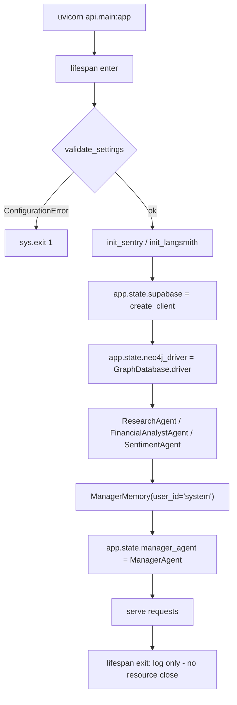
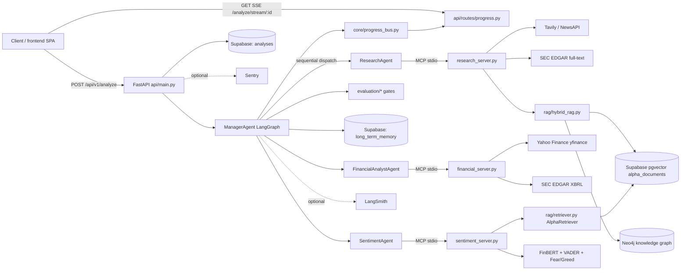
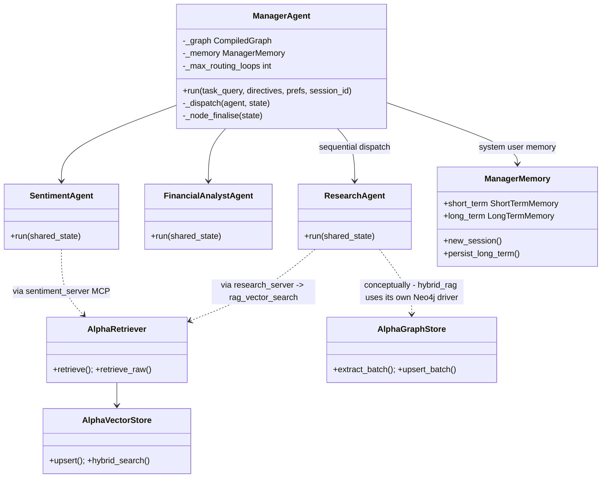
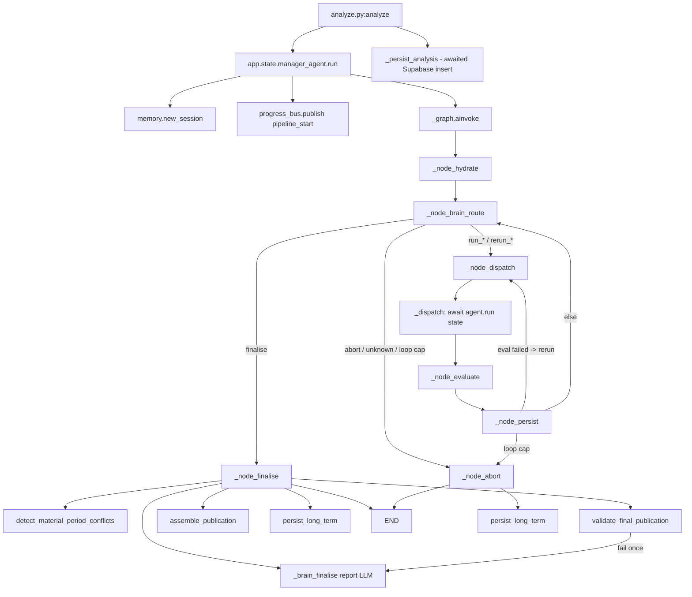
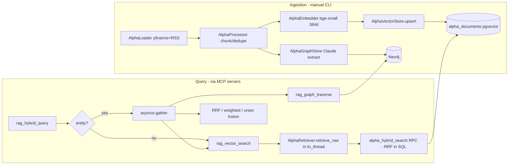
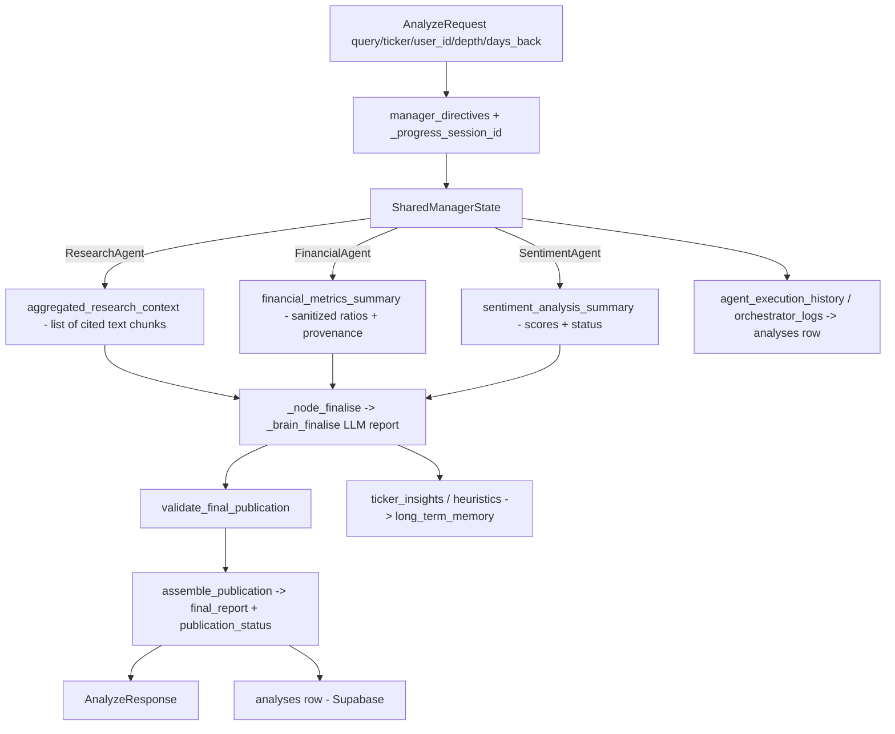
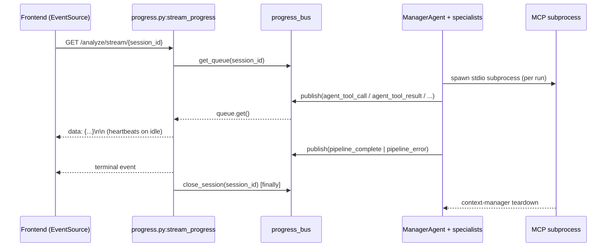

# Project Architecture Index

Source-traceable architecture guide for a backend developer joining **AgenticAlpha** (`Behroozfili/AgenticAlphaa`).
All claims are cited as `path/file.py:Symbol` (and line numbers where stable). Facts marked **[VERIFIED]** were read directly from source; **[INFERRED]** items are strong inferences; open runtime questions live in §19.

---

## 1. Executive Summary

AgenticAlpha is an async, multi-agent financial-analysis backend:

- **FastAPI service** (`api/main.py`) exposes `POST /api/v1/analyze` and an SSE progress stream `GET /api/v1/analyze/stream/{session_id}`.
- A **LangGraph orchestrator**, `agents/manager_agent.py:ManagerAgent`, routes work through a `hydrate → brain_route → dispatch → evaluate → persist → (loop | finalise | abort)` state machine (max `MAX_ROUTING_LOOPS`, default 8).
- Three **specialist agents** — `ResearchAgent`, `FinancialAnalystAgent`, `SentimentAgent` — each run their own nested LangGraph and call tools over **MCP stdio subprocesses** (`tools/*/{research,financial,sentiment}_server.py`).
- **Hybrid RAG**: Supabase pgvector + Postgres FTS (RRF fusion, `rag/vector_store.py`) plus a Neo4j knowledge graph (`rag/graph_store.py`, `rag/hybrid_rag.py`).
- **Evaluation/publication gates** (`evaluation/`) deterministically validate the final report and can block or downgrade publication.
- **Persistence**: Supabase tables `analyses` (per-request results) and `long_term_memory` (cross-session heuristics/preferences); vector data in `alpha_documents`.
- **Observability**: optional Sentry + LangSmith (`core/observability.py`).
- LLM: Anthropic Claude (`claude-haiku-4-5` default), called via the synchronous SDK wrapped in `asyncio.to_thread`.

The frontend is a single HTML page (`frontend/alpha-agent-app.html`) served at `/` — out of scope beyond the HTTP boundary.

---

## 2. Repository Map

| Path | Role |
|---|---|
| `api/main.py` | FastAPI app, `lifespan`, app-scoped resources, route registration **[VERIFIED]** |
| `api/routes/analyze.py` | `POST /api/v1/analyze` — main pipeline entry; persists to `analyses` |
| `api/routes/progress.py` | SSE stream of pipeline progress events |
| `api/dependencies.py` | `get_user_id`, `get_manager_memory` DI |
| `api/config.py` | Pydantic `Settings`, `validate_settings()` |
| `api/core/exceptions.py` | Domain exception hierarchy (`AlphaAgentError` etc.) |
| `agents/manager_agent.py` | Orchestrator LangGraph (7 nodes) |
| `agents/research_agent.py` | Brain→Executor→Checker research loop, MCP client |
| `agents/financial_agent.py` | Brain→extract→compute→checker financial loop, MCP client |
| `agents/sentiment_agent.py` | Brain-plan→execute→brain-analyze sentiment loop, MCP client |
| `agents/state.py` | `SharedManagerState`, per-agent graph states |
| `tools/research_tools/research_server.py` | MCP server: Tavily, NewsAPI, SEC EDGAR full-text, RAG tools |
| `tools/financial_tools/financial_server.py` | MCP server: 39 registered tools (Yahoo, SEC XBRL, ratio/DCF calcs) |
| `tools/sentiment_tools/sentiment_server.py` | MCP server: retrieval + FinBERT + VADER + Fear/Greed |
| `rag/` | Loader, processor, embedder, vector store, graph store, hybrid query, ingestion, seeding |
| `memory/manager_memory.py` | `ManagerMemory` = `ShortTermMemory` + `LongTermMemory` (Supabase) |
| `core/progress_bus.py` | In-process asyncio queue bus for SSE events |
| `core/observability.py` | Sentry / LangSmith init |
| `core/error_handler.py` | Sentry capture helpers/decorators |
| `evaluation/` | `final_publication.py`, `recommendation_gate.py`, `publication_policy.py`, period-conflict QA |
| `scheduler/daily_refresh.py` | **Empty stub** — one comment line only **[VERIFIED]** |
| `infra/*.yaml` | AWS ECR/ECS/OIDC CloudFormation |
| `.github/workflows/deploy.text` | CI (ruff + unit tests + Docker build) and ECR/ECS deploy |
| `Dockerfile` | Multi-stage uv build; `CMD uvicorn api.main:app --reload --port 3000` |
| `docker-compose.yml` | **Empty file (0 bytes)** **[VERIFIED]** |
| `main.py` (root) | Hello-world stub, not an entry point |
| `frontend/alpha-agent-app.html` | SPA served at `/` |

Excluded as evidence per task rules: `.git/`, caches, venvs, generated reports/test output, `package-lock.json`, `AgenticAlpha_Linear_Import_Ready.csv`.

Setup facts: no `AGENTS.md`, no `.pre-commit-config.yaml`, no `.husky/` **[VERIFIED]**. Dependency manager is `uv` (`uv.lock` committed); `uvicorn` is only in `requirements.txt`, so the Dockerfile installs it explicitly (`Dockerfile:47-50`).

---

## 3. Application Entry Points

1. **Production/dev ASGI app — `api.main:app`** **[VERIFIED]**
   - Local: `uvicorn api.main:app --reload --port 3000` (documented in `api/main.py` header; same command in `Dockerfile:86` CMD, including `--reload`, which is unusual for production).
2. **Root `main.py`** — a stub printing `"Hello from agenticalpha!"`; exists only as the `pyproject.toml` package placeholder (`Dockerfile:44` confirms: `--no-install-project : the root package is a stub; we run from source`). Never imported by the app. **[VERIFIED]**
3. **MCP tool servers** — spawned as `python tools/<x>_tools/<x>_server.py` subprocesses by each specialist agent (e.g. `agents/research_agent.py:_MCP_SERVER_PARAMS`). Not started manually.
4. **Batch/CLI entry points (manual):**
   - `python -m rag.ingestion` → `rag/ingestion.py:run_ingestion_pipeline` (default tickers `["MSFT","NVDA"]`).
   - `rag/seed.py` → seeds vector + graph stores for a ticker list.
   - `evaluation/run_ragas.py` → RAGAS evaluation.
5. **Scheduler** — `scheduler/daily_refresh.py` contains only `# Alpha-Agent Node: daily_refresh.py`; **no scheduled entry point exists in code** (README mentions a `daily_refresh.yml` workflow, but only `deploy.text` exists in `.github/workflows/`). **[VERIFIED]**

---

## 4. Startup Flow

`api/main.py:lifespan` (asynccontextmanager) **[VERIFIED]**:

1. `validate_settings()` (`api/config.py`) — hard-fails (`sys.exit(1)`) on `ConfigurationError` (missing `ANTHROPIC_API_KEY`, `SUPABASE_URL`, `SUPABASE_SERVICE_ROLE_KEY`).
2. `init_sentry(app_env=…)` and `init_langsmith()` (`core/observability.py`) — both no-op gracefully when DSN/key are unset.
3. `app.state.supabase = create_client(SUPABASE_URL, SUPABASE_KEY)` — app-scoped **sync** Supabase client.
4. `app.state.neo4j_driver = GraphDatabase.driver(NEO4J_URI, …)` — app-scoped **sync** Neo4j driver.
5. Instantiate specialists: `ResearchAgent()`, `FinancialAnalystAgent()`, `SentimentAgent(server_script_path=…)`. Each compiles its LangGraph at construction; MCP subprocesses are **not** started here.
6. `system_memory = ManagerMemory(user_id="system", supabase_client=app.state.supabase)` — warm-up memory.
7. `app.state.manager_agent = ManagerAgent(research_agent=…, financial_agent=…, sentiment_agent=…, memory=system_memory, model=ANTHROPIC_MODEL, max_routing_loops=MAX_ROUTING_LOOPS)` — one app-scoped orchestrator shared by all requests.
8. `yield` → serve requests.
9. **Shutdown**: logging only. No `supabase` close, no `neo4j_driver.close()`, no specialist teardown. **[VERIFIED]** (see §19-Q22).



---

## 5. High-Level Architecture



Layers: **API** (routing/DI/persistence of results) → **Orchestration** (manager graph + shared state) → **Specialists** (nested graphs) → **Tools** (MCP subprocess servers) → **Data** (Supabase, Neo4j, external APIs) → **Gates** (evaluation) → **Events** (progress bus/SSE).

---

## 6. Main Runtime Flows

### 6.1 Successful analysis request

```mermaid
sequenceDiagram
    participant C as Client
    participant R as analyze.py:analyze
    participant M as ManagerAgent
    participant S as Specialists
    participant E as evaluation/*
    participant DB as Supabase

    C->>R: POST /api/v1/analyze
    R->>R: analysis_id = req.session_id or uuid4()
    R->>M: run(task_query, directives, prefs, client_session_id)
    M->>M: memory.new_session(); publish(pipeline_start)
    loop until finalise/abort (max MAX_ROUTING_LOOPS)
        M->>M: brain_route (Claude picks run_*/rerun_*/finalise/abort)
        M->>S: _dispatch -> await agent.run(shared_state)
        S-->>M: shared_state + summary field
        M->>M: evaluate -> persist (short-term memory)
    end
    M->>E: finalise: conflicts check, _brain_finalise, validate_final_publication
    E-->>M: passed / regeneration / blocked
    M->>M: assemble_publication; persist_long_term(); publish(pipeline_complete)
    M-->>R: result dict
    R->>DB: _persist_analysis -> analyses insert (awaited)
    R-->>C: AnalyzeResponse(status=completed)
```

### 6.2 Failed / degraded analysis
- Any exception escaping `ManagerAgent.run()` (it wraps graph failure in `RuntimeError` after `publish(pipeline_error)`) is caught in `api/routes/analyze.py:analyze`'s `except Exception` — status becomes `"failed"`, a fallback publication is built via `assemble_publication("", {passed:False,…}, {})`, the row is still persisted, and an `AnalyzeResponse` (not an HTTP 500 from `AgentError`) is returned. **[VERIFIED]**
- Degradation inside a run: specialist tool errors become error strings in context (research), `errors[]` entries (financial), or `ERROR/NO_DATA/LOW_COVERAGE` statuses (sentiment); the manager `evaluate` node can trigger `rerun_*`, and the publication policy downgrades output (`LIMITED_REPORT`, `BLOCKED_RECOMMENDATION`, `DATA_INSUFFICIENT`).

### 6.3 Research execution — see §10.1.
### 6.4 Financial execution — see §10.2.
### 6.5 Sentiment execution — see §10.3.
### 6.6 Final synthesis & publication — see §10.4 / §17.
### 6.7 Live progress (SSE) — see §13.
### 6.8 Long-term memory — see §12.2.
### 6.9 RAG ingestion & retrieval — see §10.5.

---

## 7. Important Functions

| Function | Location | Why it matters |
|---|---|---|
| `lifespan` | `api/main.py` | Builds every app-scoped resource; the only startup/shutdown hook |
| `analyze` | `api/routes/analyze.py:analyze` | The single business endpoint; error fallback + persistence |
| `_persist_analysis` | `api/routes/analyze.py` | Writes the `analyses` row; **awaited despite "fire-and-forget" docstring** |
| `get_user_id` / `get_manager_memory` | `api/dependencies.py` | DI identity (`X-User-Id` header or `DEFAULT_USER_ID`) |
| `validate_settings` | `api/config.py` | Startup gate for required env vars |
| `ManagerAgent.run` | `agents/manager_agent.py` | Session setup, graph invoke, pipeline_start/complete/error events |
| `ManagerAgent._dispatch` | same | `state = await agent.run(state)` — sequential specialist execution |
| `ManagerAgent._node_finalise` | same | Conflict gate → report generation → validation → regeneration → publication → long-term persist |
| `ResearchAgent._executor_node` | `agents/research_agent.py:314` | Plan parsing, MCP calls, duplicate-signature skip, SEC section-coverage skip |
| `ResearchAgent._checker_node` | `agents/research_agent.py:508` | LLM sufficiency verdict with per-chunk audit budget |
| `FinancialAnalystAgent._execute_data_extraction` | `agents/financial_agent.py` | Fixed 5-tool Yahoo/SEC extraction sequence |
| `FinancialAnalystAgent._execute_ratio_computation` | same (`_call` helper, line ~516) | Ratio/DCF tool calls with `_period` provenance labels |
| `SentimentAgent._execute_sentiment_pipeline` | `agents/sentiment_agent.py` | Fixed 4-tool pipeline: retrieve → FinBERT → VADER → fear/greed |
| `publish` / `get_queue` / `close_session` | `core/progress_bus.py` | Bounded, non-blocking in-process event bus |
| `stream_progress` | `api/routes/progress.py` | SSE loop with heartbeat, terminal-event exit, `finally: close_session` |
| `rag_hybrid_query` | `rag/hybrid_rag.py` | Entity resolution → `asyncio.gather(vector, graph)` → RRF/weighted/union fusion |
| `AlphaRetriever.retrieve_raw` | `rag/retriever.py:109` | 4-stage retrieval pipeline (hybrid → freshness → diversity → token budget) |
| `AlphaVectorStore.hybrid_search` | `rag/vector_store.py:229` | Calls Postgres RPC `alpha_hybrid_search` (RRF in SQL) |
| `run_ingestion_pipeline` | `rag/ingestion.py:33` | Manual ETL: load → chunk → embed → pgvector upsert → Neo4j graph upsert |
| `validate_final_publication` | `evaluation/final_publication.py` | Deterministic multi-check gate; fails closed |
| `assemble_publication` | `evaluation/publication_policy.py` | Grades/strips report sections; assigns publication status |
| `build_recommendation_gate` / `contains_actionable_recommendation` | `evaluation/recommendation_gate.py` | Confidence-tiered actionable-language gate |
| `LongTermMemory.persist` | `memory/manager_memory.py` | Supabase upsert of `long_term_memory` row |
| `init_sentry` / `init_langsmith` | `core/observability.py` | Optional observability, direct env reads |

---

## 8. Important Classes

| Class | Location | Role |
|---|---|---|
| `ManagerAgent` | `agents/manager_agent.py` | App-scoped orchestrator; owns compiled 7-node graph + system memory |
| `ResearchAgent` | `agents/research_agent.py` | Brain/Executor/Checker nested graph; MCP client to research server |
| `FinancialAnalystAgent` | `agents/financial_agent.py` | Brain/extract/compute/checker graph; deterministic sanity checks |
| `SentimentAgent` | `agents/sentiment_agent.py` | Brain-plan/execute/brain-analyze graph; session held during graph run |
| `SharedManagerState` (TypedDict) | `agents/state.py` | Cross-agent contract: `task_query`, `manager_directives`, `aggregated_research_context`, `financial_metrics_summary`, `sentiment_analysis_summary`, `agent_execution_history`, `orchestrator_logs`, `final_report` |
| `ManagerGraphState` / `ResearchAgentState` / `FinancialAgentState` / `SentimentAgentState` | `agents/state.py` | Per-graph LangGraph states |
| `ManagerMemory` | `memory/manager_memory.py` | Facade: `ShortTermMemory` (per-session, in-RAM) + `LongTermMemory` (Supabase) |
| `AlphaRetriever` | `rag/retriever.py:34` | Multi-stage retrieval with bypassable stages (`apply_*` flags) |
| `AlphaVectorStore` | `rag/vector_store.py:170` | Supabase pgvector wrapper; documents required SQL schema in its docstring |
| `AlphaGraphStore` | `rag/graph_store.py:111` | Claude entity/relation extraction → Neo4j MERGE |
| `AlphaLoader` / `AlphaProcessor` / `AlphaEmbedder` | `rag/loader.py`, `rag/processor.py`, `rag/embedding_manager.py` | Ingestion ETL stages (yfinance news + Reddit RSS → chunks → 384-dim embeddings) |
| `Settings` | `api/config.py` | Pydantic settings; `SUPABASE_KEY` aliased from `SUPABASE_SERVICE_ROLE_KEY` |
| `AnalyzeRequest` / `AnalyzeResponse` | `api/routes/analyze.py` | API contract |
| `AlphaAgentError` hierarchy | `api/core/exceptions.py` | `ValidationError`, `AgentError`, `AgentTimeoutError`, `MemoryError`, `ExternalServiceError`, `ConfigurationError` |



---

## 9. Critical Call Graph



---

## 10. Subsystem Architecture

### 10.1 Research subsystem
- Graph: `brain → executor → checker → (brain | END)` (`agents/research_agent.py:_build_graph`), recursion limit `(max_loops+1)*3`.
- **Plan → tools**: `_brain_node` (lines 226-307) asks Claude for a JSON action plan (`{"tool": …, "arguments": …}` list); `_executor_node` (314-501) parses it with `_parse_plan`, injects the ticker via `ensure_ticker_argument`, and calls each tool over a per-run MCP stdio session (`AsyncExitStack` + `stdio_client` + `ClientSession`, lines 371-378).
- **Duplicate avoidance**: exact `tool_call_signature(tool, args)` skip (line 394-408) + SEC section-coverage subset skip for `sec_edgar_filing` (410-428); skips insert explanatory notice chunks instead of re-fetching.
- **Sufficiency**: `_checker_node` (508-633) budgets each chunk (`max(800, 12000/len)` chars, truncation-marked) so all tool calls stay visible, then asks Claude for `{"is_complete", "feedback"}`; `_should_continue` (639+) forces END at `loop_counter >= max_loops` else loops on `is_complete=False`.
- Result: chunks + optional `context_synthesizer` summary appended to `aggregated_research_context` (lines 204-211).
- MCP server (`tools/research_tools/research_server.py`) tools: `tavily_search`, `news_search`, `sec_edgar_search`, `sec_edgar_filing`, `rag_vector_search`, `rag_graph_traverse`, `rag_hybrid_query`, `comprehensive_analysis`.

### 10.2 Financial subsystem
- Graph: `brain → extract → compute → checker → (brain | END)`, `max_loops=3` default (`agents/financial_agent.py:__init__`).
- **Extraction** (`_execute_data_extraction`, ~line 190-460) is a fixed sequence, not LLM-selected: `tool_get_financial_ratios` → `tool_get_peer_comparison` (only when static peer map has entries) → `tool_get_revenue_growth` → `tool_get_xbrl_financials` → `tool_get_balance_sheet_snapshot`. **[VERIFIED]**
- **Computation** (`_execute_ratio_computation` via `_call`, lines 516-1130) calls, conditionally on available inputs: `tool_calc_pe`, `tool_calc_roe`, `tool_calc_net_margin`, `tool_calc_debt_to_equity`, `tool_calc_cagr`, `tool_build_forecast`, `tool_calc_dcf_scenarios`, `tool_calc_dcf_multi_factor_monte_carlo`, `tool_calc_net_debt_to_ebitda`, `tool_calc_fcf_margin`, `tool_calc_fcf_yield`, `tool_calc_ocf_ratio`, `tool_calc_reverse_dcf`, `tool_calc_roic`, `tool_calc_roce`, `tool_calc_debt_ratio`, `tool_calc_equity_ratio`, `tool_calc_altman_z_score`, `tool_calc_composite_score`. Each result is tagged `_inputs` and `_period` provenance ("annual:…", "ttm", "mrq", "mixed").
- **Checker**: deterministic sanity validation first (range/consistency checks), then optional Claude audit; final summary passes `sanitize_nans()` before returning to shared state.
- Earnings quality is computed locally (`normalize_earnings_quality`, line 558), not via MCP.

### 10.3 Sentiment subsystem
- Graph: `brain_plan → execute → (brain_plan | analyze) → END`, `max_loops=2`; MCP session opened around the whole graph run (`stdio_client` + `ClientSession` context managers in `run`, session cleared in `finally`).
- Fixed executor pipeline: `retrieve_social_data → analyze_finbert → score_vader → calculate_fear_greed`; each server call offloads sync work via `asyncio.to_thread` (`tools/sentiment_tools/sentiment_server.py:452-505`).
- `retrieve_social_data` uses `AlphaRetriever.retrieve_raw()` with diversity/token-budget stages disabled for breadth (retriever `apply_*` flags; server lines 137-152).
- Statuses: `NO_DATA`, `ERROR`, `LOW_COVERAGE`, `VALID` — consumed by the recommendation gate.

### 10.4 Evaluation / publication gates
- `evaluation/final_publication.py:validate_final_publication` — deterministic checks (earnings quality, period consistency, valuation bridge, scenarios, arithmetic, typed-claim fidelity, sentiment-evidence fidelity, gate consistency, repeated metrics, management-quote fidelity, low-confidence sentiment scope). Fails **closed** if the validator itself raises.
- `evaluation/recommendation_gate.py` — confidence tiers `LOW→SCENARIO_SUMMARY_ONLY`, `MEDIUM→CONDITIONAL_ONLY`, `HIGH→ACTIONABLE_ALLOWED`; requires financial sanity pass, sentiment `VALID`, and no unresolved QA period findings for actionable language ("buy/sell/accumulate/…").
- `evaluation/publication_policy.py:assemble_publication` — strips insufficient sections, suppresses actionable language, assigns `PUBLISHED`, `PUBLISHED_WITH_WARNINGS`, `LIMITED_REPORT`, `BLOCKED_RECOMMENDATION`, `DATA_INSUFFICIENT`.

### 10.5 RAG subsystem
- **Query side** (`rag/hybrid_rag.py`): module-level lazy singletons — an `AlphaVectorStore` + `AlphaRetriever` (env-configured) and a lazily-created **async** Neo4j driver (`_get_neo4j`, separate from the app's lifespan driver). `rag_vector_search` runs the full retriever pipeline in `asyncio.to_thread`; `rag_hybrid_query` resolves the entity (arg or uppercase ticker regex), falls back to vector-only when no entity, else `asyncio.gather(rag_vector_search, rag_graph_traverse)` fused via RRF (default), weighted, or union.
- **Ingestion side** (`rag/ingestion.py`, manual): `AlphaLoader` (yfinance news + Reddit RSS) → `AlphaProcessor` (chunk + dedupe) → `AlphaEmbedder` (BAAI/bge-small-en-v1.5, 384-dim) → `AlphaVectorStore.upsert` (idempotent on `url_hash,chunk_index`) → `AlphaGraphStore` (Claude entity/relation extraction → Neo4j MERGE; closed in `finally`, `ingestion.py:183-185`).



---

## 11. Data Flow



Ownership rule **[VERIFIED]** (`agents/state.py` + each agent's `run`): the manager owns query/directives/history/logs/final report; each specialist writes exactly one top-level summary field and returns the whole `SharedManagerState`, which `_dispatch` re-adopts (`state = await agent.run(state)`), so merging is by object handoff, not concurrent reduction.

---

## 12. Persistence

### 12.1 `analyses` (Supabase)
Schema documented in `api/routes/analyze.py` docstring: `analysis_id PK, user_id, query, ticker, status, final_report, financial_metrics JSONB, sentiment_analysis JSONB, agent_execution_history JSONB, orchestrator_logs JSONB, error_message, duration_s, created_at, completed_at`. One synchronous `insert(...).execute()` per request in `_persist_analysis` (inside an `async def`; runs on the event loop — see §19-Q11).

### 12.2 `long_term_memory` (Supabase)
Schema in `memory/manager_memory.py` docstring: `user_id PK, operational_heuristics JSONB, ticker_insights JSONB, user_preferences JSONB, updated_at`. `LongTermMemory.load()` selects on construction; `persist()` upserts `on_conflict="user_id"`. Called from `ManagerAgent._node_finalise` and `_node_abort` (non-fatal try/except). Because the manager holds the lifespan-created `ManagerMemory(user_id="system")`, these writes land under `user_id="system"` **[VERIFIED]** — see §18.

### 12.3 `alpha_documents` + `alpha_hybrid_search` RPC (Supabase pgvector)
Full required SQL (table, HNSW index, GIN FTS index, RRF RPC with fiscal-period filter args) is embedded in `rag/vector_store.py:1-153`. Upserts are idempotent on `(url_hash, chunk_index)`.

### 12.4 Neo4j
Nodes: `Company, Person, GeopoliticalEvent, MacroEvent, Product, Sector`; relationships: `COMPETES_WITH, SUPPLIES_TO, AFFECTED_BY, LED_BY, PART_OF, RELATED_TO, ACQUIRED_BY` (`rag/graph_store.py:14-19`). Populated only by ingestion; queried by `rag_graph_traverse`.

**Atomicity**: no application-owned transaction spans the `analyses` insert, long-term-memory upsert, and vector writes — each Supabase call is individually atomic at the PostgREST level; a crash between finalise-persist and route-persist can leave partial state. **[VERIFIED — absence of any transaction construct in source]**

---

## 13. Workers / Events / Async Processing

- **No background workers, no task queue, no scheduler.** `scheduler/daily_refresh.py` is an empty stub; the README's `daily_refresh.yml` workflow does not exist (`.github/workflows/` contains only `deploy.text`). **[VERIFIED]**
- **Progress bus** (`core/progress_bus.py`): module-level `dict[str, asyncio.Queue]`, max 300 events/queue, `put_nowait` with drop-on-full (never blocks the pipeline), `close_session` pops the queue. **Process-local** — with multiple uvicorn workers the SSE consumer may land in a different process than the publisher; a shared broker (e.g. Redis) would be needed.
- **Event types** (published from manager + specialists): `pipeline_start`, `hydrate`, `route`, `dispatch_start`, `dispatch_end`, `agent_brain`, `agent_tool_call`, `agent_tool_result`, `agent_checker`, `evaluate`, `finalise`, `pipeline_complete`, `pipeline_error`.
- **SSE** (`api/routes/progress.py:stream_progress`): loop on `queue.get()` with heartbeat timeout (`: heartbeat` comment frames), exits on client disconnect or terminal event, `finally: close_session(session_id)` guarantees queue cleanup.
- **MCP subprocesses**: one stdio `python <server>.py` subprocess per specialist **per run** — research opens/closes per executor iteration (`AsyncExitStack` in `_executor_node`); sentiment holds one session for its whole graph run; financial similarly opens a session per extraction/compute phase. Teardown via async context managers / `finally`. **[VERIFIED for research & sentiment; financial uses the same `ClientSession` context pattern]**



---

## 14. External Integrations

| Integration | Where | Notes |
|---|---|---|
| Anthropic Claude | all agents, `rag/graph_store.py`, finalise/checkers | Sync SDK wrapped in `asyncio.to_thread` at every agent call site **[VERIFIED via grep]** |
| Supabase (PostgREST) | `api/main.py`, `analyze.py`, `manager_memory.py`, `rag/vector_store.py` | Sync client; multiple independent clients created (app-scoped + RAG module + sentiment server subprocess) |
| Neo4j | `api/main.py` (sync driver, unused by RAG), `rag/hybrid_rag.py` (async driver), `rag/graph_store.py` (ingestion driver) | Three distinct driver instances/ownerships |
| Tavily / NewsAPI | `tools/research_tools/tavily_search.py`, `news_search.py` | Direct env key reads |
| SEC EDGAR | `tools/research_tools/sec_edgar.py` (full-text search + filing text, query sanitization, term cap 6) and `tools/financial_tools/sec_edgar.py` (CIK/XBRL companyfacts/filing lists) | **Two intentionally different modules** — see §18 |
| Yahoo Finance | `tools/financial_tools/yahoo_finance.py` via `yfinance`; also `rag/loader.py` for news | Sync HTTP inside MCP subprocess |
| FinBERT / VADER / sentence-transformers | sentiment server, `rag/embedding_manager.py` | Heavy models lazy-loaded; ~200 MB embedder singleton |
| Sentry | `core/observability.py`, breadcrumbs across agents/tools | Optional; `send_default_pii=False` |
| LangSmith | `core/observability.py`, `@traceable` decorators | Optional; sets `LANGCHAIN_*` env vars |
| AWS ECS/ECR | `infra/*.yaml`, `.github/workflows/deploy.text` | OIDC-role deploy after lint+unit-test+build |

---

## 15. Configuration and Dependency Wiring

- **Canonical config**: `api/config.py:Settings` (pydantic-settings, `.env`), validated at startup by `validate_settings()`. `SUPABASE_KEY` is populated from env var `SUPABASE_SERVICE_ROLE_KEY` via `validation_alias`.
- **Direct env reads bypassing `Settings`** **[VERIFIED via grep]**: `memory/manager_memory.py`, `tools/research_tools/news_search.py`, `tools/research_tools/tavily_search.py`, `tools/financial_tools/sec_edgar.py` (`SEC_EDGAR_USER_AGENT`), `tools/sentiment_tools/sentiment_server.py` (Supabase keys, retrieval stage sizes, fear/greed weights), `rag/ingestion.py`, `rag/vector_store.py`, `rag/hybrid_rag.py` (`NEO4J_URI` etc. — `os.environ[...]` with **no fallback**; missing values raise `KeyError` at first RAG call), `rag/evaluation.py`, `rag/graph_store.py`, `evaluation/run_ragas.py`, `agents/research_agent.py`, `core/observability.py` (`SENTRY_DSN`, `LANGSMITH_API_KEY`, `LANGSMITH_PROJECT`). Rationale stated in `rag/ingestion.py:47`: "rag/ must not depend on api/".
  - This is also *necessary* for MCP servers: they run as separate Python subprocesses and inherit the environment, not the parent's `Settings` object. **[INFERRED from subprocess model]**
- **FastAPI DI**: `get_user_id` (header `X-User-Id` → `DEFAULT_USER_ID`) → `get_manager_memory` (request-scoped `ManagerMemory` on the app's Supabase client). Note the request-scoped memory is only used to read preferences in the route; the manager runs on the lifespan `"system"` memory.
- **Agent wiring**: constructor injection in `lifespan` (specialists, memory, model, max loops); specialists allow injected `llm_client` / `mcp_server_params` for tests.

---

## 16. Critical Files to Read First

1. `api/main.py` — startup, app-scoped resources, wiring (10 min).
2. `agents/state.py` — the shared-state contract everything passes around.
3. `agents/manager_agent.py` — orchestration graph, routing rules, finalise gate.
4. `api/routes/analyze.py` — request lifecycle, error fallback, `analyses` persistence.
5. `agents/research_agent.py` — the canonical Brain/Executor/Checker + MCP client pattern (the other two agents are variations).
6. `tools/financial_tools/financial_server.py` — tool registry style shared by all three MCP servers.
7. `rag/vector_store.py` — includes the required Supabase SQL schema in the docstring.
8. `rag/hybrid_rag.py` — query-side RAG fusion and its private Neo4j driver.
9. `evaluation/final_publication.py` + `evaluation/publication_policy.py` — why reports get blocked/downgraded.
10. `core/progress_bus.py` + `api/routes/progress.py` — SSE mechanics.
11. `memory/manager_memory.py` — memory model and the `"system"` user subtlety.
12. `Dockerfile` + `.github/workflows/deploy.text` — build/deploy reality.

---

## 17. Critical Call Chains

**Happy path (condensed):**
```text
POST /api/v1/analyze
  analyze.py:analyze
    app.state.manager_agent.run()
      memory.new_session(); publish(pipeline_start)
      _graph.ainvoke(recursion_limit=(max_loops+2)*4)
        hydrate → brain_route ──run_research──▶ dispatch
          _dispatch → await ResearchAgent.run(shared)
            brain(_brain_node LLM plan) → executor(MCP stdio: tavily/news/sec/rag)
            → checker(LLM sufficiency) → [loop ≤ max_loops] → END
        evaluate → persist → brain_route ──run_financial──▶ dispatch
          FinancialAnalystAgent.run: brain → extract(5 fixed tools)
            → compute(_call ratio/DCF tools) → checker(deterministic + LLM) → END
        evaluate → persist → brain_route ──run_sentiment──▶ dispatch
          SentimentAgent.run: brain_plan → execute(retrieve→finbert→vader→fear_greed)
            → brain_analyze → END
        evaluate → persist → brain_route ──finalise──▶ _node_finalise
          detect_material_period_conflicts
          _brain_finalise (LLM report)
          validate_final_publication  ──fail──▶ regenerate once ──▶ revalidate
          narration-vs-period QA (non-blocking; high severity ⇒ limited)
          assemble_publication → persist_long_term() → END
      publish(pipeline_complete)
    _persist_analysis (awaited Supabase insert)
    return AnalyzeResponse
```

**Failure path:** `ManagerAgent.run` catches graph exceptions → `publish(pipeline_error)` → raises `RuntimeError` → `analyze`'s `except Exception` → `status="failed"` + `assemble_publication("", {passed:False}, {})` → row persisted → 200 response with failed status.

**Abort path:** `brain_route` returns `abort`/unknown, or loop cap hit → `_node_abort` → best-effort `persist_long_term()` → END → `run` still publishes `pipeline_complete` (graph completed without exception). **[INFERRED for the complete-event nuance; verified that abort is a normal END node]**

---

## 18. Things Easy to Misunderstand

1. **Root `main.py` is not the app.** The service is `api.main:app`; the root file exists only so the uv/pyproject package has a module (Docker installs deps with `--no-install-project`).
2. **"Fire-and-forget" persistence isn't.** `_persist_analysis`'s docstring says fire-and-forget, but `analyze` **awaits** it — the response is not returned until the Supabase insert finishes. **[VERIFIED]**
3. **Three user identities can diverge**: `AnalyzeRequest.user_id` (body, default `"anonymous"`) is what's written to `analyses.user_id`; `get_user_id()` (header `X-User-Id`/`DEFAULT_USER_ID`) only feeds the request-scoped preference read; the manager's long-term memory reads/writes happen under `"system"` (lifespan warm-up memory). There is no authentication reconciling them.
4. **Two SEC EDGAR modules are not accidental duplication**: `tools/research_tools/sec_edgar.py` does *full-text search + narrative filing text* (query sanitization, ≤6 terms, section extraction) for the research agent; `tools/financial_tools/sec_edgar.py` does *structured data* (ticker→CIK, filing lists, XBRL companyfacts) for the financial agent. Same domain, different semantics; both set their own User-Agent.
5. **Three Neo4j drivers**: lifespan's sync `app.state.neo4j_driver` (created but not consumed by RAG code paths), `rag/hybrid_rag.py`'s lazy async driver (used for graph traversal, module-owned, never explicitly closed by the app), and `rag/graph_store.py`'s ingestion driver (closed in ingestion's `finally`).
6. **Financial extraction is deterministic, not agentic**: the Brain plans, but `_execute_data_extraction` always runs the same 5 `tool_get_*` calls; LLM discretion applies mainly to looping/auditing. Many of the 39 registered server tools are never called by the agent (see §19-Q4).
7. **The progress bus drops events silently** when a session queue exceeds 300 items — SSE consumers can miss events by design; the pipeline never blocks on slow consumers.
8. **`--reload` in the Docker CMD** (`Dockerfile:86`) is a development flag shipped in the production image.
9. **`docker-compose.yml` is empty** — don't expect local service orchestration from it.
10. **Sentiment retrieval intentionally bypasses retriever stages** (`apply_diversity_filter=False`, larger token budget) to score many chunks; don't "fix" it to match the research defaults.
11. **Validation fails closed**: an exception inside `validate_final_publication` produces a failed validation, not a bypass.

---

## 19. Uncertainties / Runtime Verification

### Answers to the 22 source-verification questions

1. **Sole production entry?** Yes — `api.main:app` (Dockerfile CMD + module docstring). Root `main.py` is a package stub kept for pyproject; never imported. **[VERIFIED]**
2. **Manager route hydrate→finalise vs abort; loop stops?** `hydrate → brain_route`; `_should_route` maps `run_*/rerun_*→dispatch`, `finalise→finalise`, `abort`/unknown→`abort`; `dispatch→evaluate→persist`; `_should_continue_after_persist` → `abort` (loop cap), `dispatch` (eval-failure rerun), else `brain_route`. Loops stopped by `loop_counter >= max_routing_loops` in both routers plus LangGraph `recursion_limit=(max+2)*4`. **[VERIFIED]**
3. **Dispatch concurrency?** Sequential: `_dispatch` does `state = await agent.run(state)` one agent at a time; merging is whole-state handoff, each agent adding only its own summary field. **[VERIFIED]**
4. **Financial tools selected vs unreachable?** Normal run: 5 `tool_get_*` extraction tools (§10.2) + 19 compute tools listed in §10.2. Registered but **never called by the agent**: `tool_get_price_history`, `tool_get_cik`, `tool_list_filings`, `tool_get_filing_text`, `tool_calc_pb`, `tool_calc_ev_ebitda`, `tool_calc_peg`, `tool_calc_gross_margin`, `tool_calc_operating_margin`, `tool_calc_roa`, `tool_calc_current_ratio`, `tool_calc_quick_ratio`, `tool_calc_interest_coverage`, `tool_calc_asset_turnover`, `tool_calc_revenue_cagr_from_growth`, `tool_calc_dcf`, `tool_calc_dcf_monte_carlo` (the agent uses `tool_calc_dcf_scenarios` and `tool_calc_dcf_multi_factor_monte_carlo` instead). **[VERIFIED via grep of `agents/financial_agent.py` call sites]**
5. **Research plan→MCP, dedupe, sufficiency?** LLM emits a JSON action list; executor parses, injects ticker, calls tools over a per-iteration stdio session; exact-signature and SEC-section-subset duplicates are skipped with notice chunks; the checker LLM judges sufficiency on per-chunk-budgeted context, `_should_continue` caps loops. **[VERIFIED, §10.1]**
6. **Sentiment retrieval — `AlphaRetriever` or `rag_hybrid_query`?** `AlphaRetriever.retrieve_raw()` only (via `retrieve_social_data` in the sentiment server, stages relaxed). `rag_hybrid_query` is a *research*-server tool. Both ultimately hit the same `alpha_hybrid_search` RPC. **[VERIFIED]**
7. **Why `app.state.neo4j_driver` + other drivers?** Lifespan creates a sync driver on app state, but the RAG query path uses its own async module-level driver (subprocess servers couldn't share app state anyway) and ingestion creates/closes its own. The app-state driver appears unused by the analysis path and is never closed. **[VERIFIED creation/ownership; "unused" verified by absence of consumers in routes/agents]**
8. **Warm-up `ManagerMemory("system")`?** It is not just warm-up — it is the manager's permanent memory: all manager long-term reads/writes go to `user_id="system"`. Request-scoped memory (header identity) is only read for preferences in the route. **[VERIFIED]**
9. **`AnalyzeRequest.user_id` vs `get_user_id()`?** Independent values: body field (default `anonymous`) → persistence/response; header/`DEFAULT_USER_ID` → request memory DI. Nothing validates they match. **[VERIFIED]**
10. **Supabase transaction ownership?** Nobody: individual PostgREST calls only; no multi-write transaction/atomicity in application code. **[VERIFIED by absence]**
11. **Sync calls on the event loop?** Mixed. Offloaded via `asyncio.to_thread`: all Anthropic calls in agents, sentiment server retrieval/model scoring, context synthesizer. Isolated in MCP subprocesses (blocking only that subprocess's stdio loop): Yahoo/SEC/most tool HTTP. **On the API event loop**: `_persist_analysis`'s Supabase insert, lifespan's `create_client`/driver creation, and `LongTermMemory.load/persist` (called from async manager nodes without offload). **[VERIFIED]**
12. **Is `_persist_analysis` fire-and-forget?** No — awaited inline; the docstring is stale. **[VERIFIED]**
13. **Does the route raise `AgentError`?** No. `ManagerAgent.run` raises `RuntimeError` after `pipeline_error`; the route catches all exceptions and returns a failed `AnalyzeResponse` with fallback publication. `AgentError` exists but is unused on this path. **[VERIFIED]**
14. **Deterministic finalisation sequence?** (1) `detect_material_period_conflicts` — blocking conflicts short-circuit to a failed validation + limited publication; (2) recommendation gate; (3) `_brain_finalise` report; (4) `validate_final_publication`; (5) on failure, one regeneration with `required_regeneration_context`, revalidate; (6) second failure ⇒ blocked candidate, graded publication without the invalid report; (7) non-blocking narration/period QA (high severity ⇒ limited); (8) `assemble_publication`. **[VERIFIED]**
15. **Who calls `persist_long_term()`; guaranteed?** `_node_finalise` and `_node_abort`, both wrapped in non-fatal try/except. Not guaranteed on process crash, on exceptions before those nodes, or if the graph raises — best-effort only. **[VERIFIED]**
16. **Progress events/cleanup/multi-worker?** Events listed in §13; cleanup via SSE `finally: close_session`; queues bounded at 300 with silent drop. **Not** multi-worker safe (process-local dict). **[VERIFIED]**
17. **RAG schema requirements?** Supabase: `alpha_documents` table + HNSW + GIN indexes + `alpha_hybrid_search` RPC (full SQL in `rag/vector_store.py` docstring), and `long_term_memory` + `analyses` tables for the app. Neo4j: node labels/relationship types in `rag/graph_store.py`; no migration tooling — SQL must be applied manually. **[VERIFIED]**
18. **Ingestion scheduled or manual?** Manual only (`python -m rag.ingestion`, `rag/seed.py`). `scheduler/daily_refresh.py` is an empty one-comment stub; no scheduler workflow exists despite the README's mention. **[VERIFIED]**
19. **Why duplicated SEC implementations?** Split by consumer semantics: research = full-text search/narrative sections; financial = CIK/XBRL/structured facts (§18-4). They share no code and differ in endpoints, sanitization, and output shape. **[VERIFIED]**
20. **Config reads bypassing `Settings`?** Full file list in §15 — 13 modules use `os.environ`/`os.getenv` directly; some (e.g. `rag/hybrid_rag.py` `NEO4J_URI`) have no fallback and raise `KeyError` at first use. **[VERIFIED via grep]**
21. **MCP subprocesses per run; teardown guaranteed?** Yes, per run (research: per executor iteration; sentiment/financial: per agent run/phase), started with `stdio_client` context managers. Teardown is guaranteed by async context managers/`finally` for normal and exception paths; not guaranteed on hard process kill. **[VERIFIED for the context-manager structure]**
22. **App-scoped resources lacking shutdown cleanup?** `app.state.supabase`, `app.state.neo4j_driver`, `app.state.manager_agent` (and its memory), the RAG module's lazy async Neo4j driver and embedder singleton — lifespan shutdown only logs. **[VERIFIED]**

### Remaining runtime-verification items (not testable statically / not run per read-only mandate)

- Whether the `alpha_hybrid_search` RPC deployed in the actual Supabase project matches the fiscal-filter signature in `rag/vector_store.py` (the code passes optional filter args the docstring says "migrations should add").
- Real event-loop impact of the non-offloaded Supabase calls under load.
- Behavior of duplicate `session_id` reuse across concurrent requests sharing one progress queue.
- Whether `pipeline_complete` is also published after the `abort` node in practice (graph ends without exception, so `run` should publish it — flagged as **[INFERRED]** in §17).
- Whether ECS deploys actually run with a single uvicorn worker (required for the in-process progress bus to work).
- Sentiment fear/greed weight defaults differ between `env.example` (0.6/0.4) and `sentiment_server.py` code defaults (0.65/0.35) — actual runtime values depend on the deployed environment.
